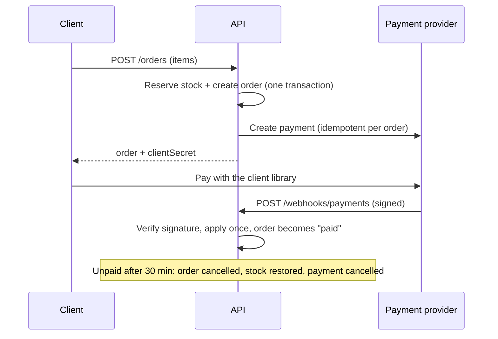

# Commerce API

A headless e-commerce backend: catalogue, inventory, orders and payments behind a REST and a GraphQL API. Built with Node.js, TypeScript, Express 5, PostgreSQL, Redis and Stripe.

"Headless" means there is no storefront: any web, mobile or back-office client can sit on top of it.

## What it does

- **Catalogue**: public product listing with search and pagination, admin-only product management.
- **Inventory you can trust**: stock is reserved with a single atomic `UPDATE ... WHERE stock >= qty`, so concurrent buyers can never oversell. Every stock change is written to an append-only `inventory_movements` table.
- **Order lifecycle**: `pending → paid → shipped → delivered`, plus `cancelled`. Illegal transitions are rejected by an explicit state machine. Prices and names are copied into the order, so later catalogue edits never rewrite history.
- **Payments**: a provider interface with a Stripe implementation (PaymentIntents, signed webhooks) and an offline mock, so the whole flow runs without any account.
- **Safe webhooks**: signatures are verified, events are processed once (retries are harmless), and a payment arriving for an already-cancelled order is flagged instead of silently applied.
- **Unpaid orders expire**: a background sweep cancels them and puts the stock back, and also cancels the payment at the provider.
- **Two APIs, one core**: REST and GraphQL call the same services, so rules and permissions cannot drift apart.
- **Roles**: `customer` and `admin`, enforced on the server. Customers see exact stock as `inStock: true/false`; admins see the number.
- **Redis, optional**: caches the public catalogue and keeps rate-limit counters shared across instances. If Redis is down the API keeps working from the database.

## Architecture

```
src/
  config.ts          Environment validation (fails fast with a readable list of problems)
  db.ts              Pool, transactions, migration runner
  auth.ts            Signed tokens (JWT, HS256)
  domain/            Order state machine (pure, no I/O)
  services/          Business rules: users, products, orders (shared by REST and GraphQL)
  payments/          Provider interface, Stripe and mock implementations
  http/              Express app, routes, middleware (auth, errors, rate limits, security headers)
  graphql/           Schema and resolvers (thin wrappers over the services)
  redis.ts           Cache-aside helper with a no-op fallback
  server.ts          Entrypoint: migrations, listening, expiry sweep, graceful shutdown
db/migrations/       Plain SQL migrations
scripts/             migrate, seed, mock-pay, demo
tests/               Integration tests against real PostgreSQL and Redis
```

### Payment flow



### Decisions worth knowing

- **Money is integer cents**, never floats. A single currency (USD) is supported.
- **Row locks instead of retries.** Orders lock product rows in a fixed order and cancellations lock the order row, so concurrent requests queue up instead of deadlocking or double-spending. This is covered by tests that fire 25 simultaneous buyers at 10 units of stock, and that race a payment against a cancellation.
- **Order not found and order not yours look the same** (404), so ids cannot be probed.
- **Validation at the service layer** (zod, unknown fields rejected), so REST and GraphQL are protected by the same rules.

## Getting started

Requirements: Node.js 20.6+ and Docker (or your own PostgreSQL 14+; Redis is optional).

```bash
npm install
cp .env.example .env          # Windows cmd: copy .env.example .env  ->  then set JWT_SECRET
docker compose up -d          # PostgreSQL on port 5432 and Redis on 6379
npm run seed                  # tables, two demo accounts, 12 products
npm run dev                   # http://localhost:4000
```

In a second terminal, `npm run demo` walks through the whole flow (browse, register, order, pay, ship, GraphQL) and prints each step.

PostgreSQL is published on port **5432**. If you use your own server, change `DATABASE_URL` in `.env`.

Demo accounts (password `demo-password-123`, or `SEED_PASSWORD`): `admin@example.com` and `customer@example.com`.

### Paying an order without Stripe

With `PAYMENT_PROVIDER=mock` the API behaves like Stripe: an order stays `pending` until a signed webhook arrives. Simulate it with:

```bash
npm run mock:pay -- <orderId>           # payment succeeded
npm run mock:pay -- <orderId> --fail    # payment failed, order stays pending
```

### Using Stripe

1. Set `PAYMENT_PROVIDER=stripe`, `STRIPE_SECRET_KEY` (a `sk_test_...` key) and `STRIPE_WEBHOOK_SECRET`.
2. Forward events to your machine with the Stripe CLI: `stripe listen --forward-to localhost:4000/webhooks/payments`. It prints the `whsec_...` secret to use.
3. Create an order, then confirm the returned `clientSecret` with Stripe's client library or test tools.

## Configuration

| Variable | Default | Meaning |
| --- | --- | --- |
| `DATABASE_URL` | required | PostgreSQL connection string |
| `JWT_SECRET` | required | At least 32 characters |
| `REDIS_URL` | unset | Enables the catalogue cache and shared rate limiting |
| `PAYMENT_PROVIDER` | `mock` | `mock` or `stripe` (`mock` is refused in production) |
| `STRIPE_SECRET_KEY`, `STRIPE_WEBHOOK_SECRET` | unset | Required for `stripe` |
| `PORT` | `4000` | HTTP port |
| `CORS_ORIGINS` | none | Comma-separated allowed origins; no CORS headers if empty |
| `ORDER_EXPIRY_MINUTES` | `30` | How long an unpaid order holds stock |
| `CATALOG_CACHE_TTL_SECONDS` | `15` | Lifetime of cached catalogue pages |
| `RATE_LIMIT_MAX` | `300` | Requests per minute per IP |
| `AUTH_RATE_LIMIT_MAX` | `20` | Register/login attempts per 15 minutes per IP |
| `TRUST_PROXY` | `0` | Number of reverse proxies in front of the API |
| `LOG_LEVEL` | `info` | `silent`, `error`, `warn`, `info`, `debug` |

## REST API

Send the token as `Authorization: Bearer <token>`. Errors always look like `{ "error": { "code", "message", "details?" } }`.

| Method and path | Who | What |
| --- | --- | --- |
| `POST /auth/register` | anyone | Create a customer account, returns a token |
| `POST /auth/login` | anyone | Returns a token (valid for 1 hour) |
| `GET /auth/me` | signed in | Current user |
| `GET /products?q=&limit=&offset=` | anyone | Active products (`includeInactive=true` for admins) |
| `GET /products/:id` | anyone | One product |
| `POST /products` | admin | Create a product |
| `PATCH /products/:id` | admin | Change name, description, price or visibility |
| `POST /products/:id/inventory` | admin | Add or remove stock: `{ "delta": -3 }` |
| `POST /orders` | signed in | `{ "items": [{ "productId", "quantity" }] }` returns the order and `clientSecret` |
| `GET /orders?status=&limit=&offset=` | signed in | Your orders (all orders for admins) |
| `GET /orders/:id` | owner or admin | One order |
| `POST /orders/:id/cancel` | owner or admin | Cancel a pending order and restore stock |
| `POST /orders/:id/ship`, `/deliver` | admin | Move a paid order forward |
| `POST /webhooks/payments` | payment provider | Signed payment events |
| `GET /health` | anyone | Database and Redis status |

## GraphQL

Endpoint: `POST /graphql`, same `Authorization` header. Supports `products`, `product`, `me`, `orders`, `order`, `createOrder` and `cancelOrder`. Registration and login are REST only.

```graphql
query {
  products(search: "keyboard", limit: 5) { total data { id name priceCents inStock } }
}

mutation($items: [OrderItemInput!]!) {
  createOrder(items: $items) { clientSecret order { id status totalCents } }
}
```

Errors carry a stable `extensions.code` (for example `insufficient_stock`) so clients do not parse messages.

## Testing

Tests are integration tests against real PostgreSQL and Redis, because the interesting behaviour (locking, transactions, caching) does not exist in mocks.

```bash
docker compose up -d
npm test                  # all tests
npm run test:coverage     # with coverage; fails below 90% lines
npm run typecheck
```

The test database must end in `_test` and Redis must not be database 0; the tests refuse to run otherwise, so they can never wipe real data. Override the URLs with `TEST_DATABASE_URL` and `TEST_REDIS_URL` if needed.

## Production notes

- Build with `npm run build` and run `node dist/server.js`. Migrations are applied at startup under an advisory lock, so several instances can start together.
- Use HTTPS, a strong `JWT_SECRET`, `PAYMENT_PROVIDER=stripe` and set `TRUST_PROXY` correctly behind a load balancer, or every client will share one rate-limit bucket.
- The expiry sweep runs in every instance; this is safe because cancellation is guarded by row locks.
- Never run `npm run seed` against a real database: it creates well-known accounts (it refuses when `NODE_ENV=production`).

## Known limitations and next steps

- **No refunds.** Paid orders cannot be cancelled through the API. A payment that succeeds after its order expired is logged as an error and needs a manual refund.
- **Catalogue `inStock` can lag by up to the cache TTL.** Checkout always uses the real stock, so the worst case is a clear "insufficient stock" answer.
- No `Idempotency-Key` header on `POST /orders` yet, no refresh tokens, a single currency and no tax or shipping calculation.
- Ideas: product categories and images, carts, discounts, an admin dashboard, OpenAPI documentation, a Dockerfile for the API itself.

## License

This project is licensed under the [MIT License](LICENSE).